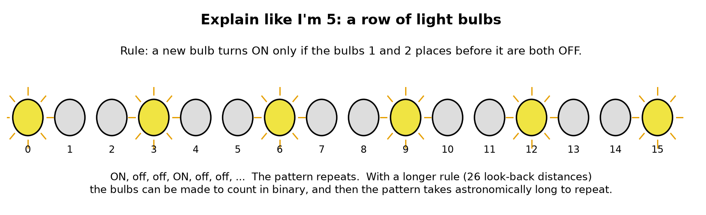
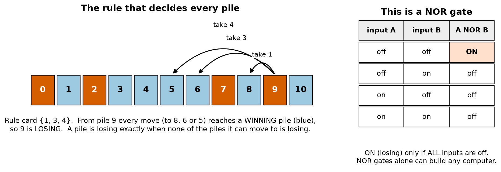
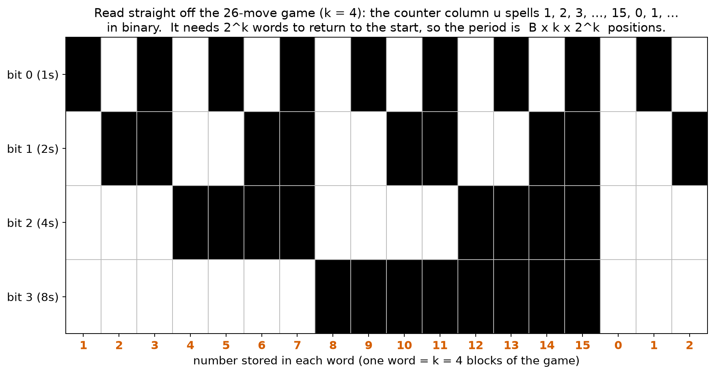

# Explain it like I'm 5 (then 12, then 17)

The same story three times, each a little deeper. Stop whenever you like.

---

## Like I'm 5

You and a friend have a pile of candies. You take turns. On your turn you must take **1 or 2**
candies. If it's your turn and the pile is empty, **you lose**.

Some piles are **bad to start from**: whatever you do, your friend can win. With the "1 or 2" rule
the bad piles are 0, 3, 6, 9, 12, ... every third one. From 3, if you take 1 your friend takes 2,
and if you take 2 your friend takes 1. Either way you are stuck at 0.

The bad piles make a pattern that **repeats**: bad, good, good, bad, good, good, ...

Now change the rule card. Maybe you can take 1, 3 or 4. The pattern changes, but it **always
repeats** eventually. Grown-up mathematicians wanted to know: **how long can the pattern go before
it repeats**, if the rule card only has a few numbers on it?

A famous mathematician guessed: "never *super* long." We showed he was wrong. We found a rule card
with 26 numbers whose pattern goes on for so long before repeating that writing the length down
takes thousands of digits.

How? We discovered that the game can secretly work like a **tiny computer that counts**:
1, 2, 3, 4, ... in computer numbers (0s and 1s). A counter takes a very, very long time to get back
to where it started, so the pattern takes a very long time to repeat.

And we made a computer check every step of our reasoning, like a super-strict teacher who never
gets tired and never lets a mistake slip by.

---

## Like I'm 12

**The game.** A pile has *n* tokens. The rule card is a short list of numbers, for example
{1, 3, 4}. On your turn you remove one of those amounts (if the pile is big enough). The player who
cannot move loses. Nobody rolls dice and nothing is hidden, so for every pile size exactly one of
the players can force a win.

**Winning and losing piles.** Call a pile *losing* if the player about to move will lose against
perfect play. There is a simple rule that decides every pile, one after another:

> A pile is **losing** exactly when **every** move from it leads to a **winning** pile.

So you can fill in a table: 0 is losing (no moves), 1 is winning (move to 0), and so on. Each new
entry only looks back at a few earlier entries, namely the ones you can move to.

**Why the pattern repeats.** Say the biggest number on the card is 20. Then each new answer depends
only on the previous 20 answers. There are only so many possible lists of 20 answers (about a
million), so some list must eventually come back. From then on everything repeats. The length of
that repeat is called the **period**.

**The question.** How long can the period be? Mathematicians wrote the rule card's size as *n* and
its biggest number as *m*. Richard Guy, one of the founders of the subject, conjectured that the
period is at most a **polynomial** in *m*: something like m² or m³ or m^100, where the exponent
depends only on *n*. Computer experiments found some surprisingly long periods, but nobody could
prove anything longer than polynomial.

**What we did.** We found rule cards with **26 numbers** whose period is about **2^(m/260)**. That
is **exponential**, and exponentials eventually beat every polynomial. So Guy's guess is false.

**The trick.** The winning/losing rule is exactly a logic gate called **NOR** ("on only if all
inputs are off"). Computers can be built entirely out of NOR gates. We arranged the numbers on the
rule card so that certain pile sizes behave like wires carrying 0s and 1s, and the NOR rule makes
them compute. The little computer we built is a **binary counter**. A *k*-bit counter goes through
2^k values before it repeats, and that is where the huge period comes from.

---

## Like I'm 17 (a high-school math student)

**Setup.** For a finite set S of positive integers, the subtraction game S has positions n ≥ 0. A
move goes from n to n − s with s ∈ S and s ≤ n. Under normal play, the P-positions (losses for the
player to move) satisfy

  n is a P-position ⟺ no n − s (s ∈ S, s ≤ n) is a P-position.

If we write w(n) = 1 for P-positions and 0 otherwise, then w(n) = NOR(w(n − s) : s ∈ S). So w is
produced by a **shift register** of length m = max S whose feedback is a single NOR gate. Since
there are at most 2^m states, w is eventually periodic with period at most 2^m.

**Guy's conjecture** (as recorded in *Unsolved Problems in Combinatorial Games*, 2019): if |S| = n
then the period is at most a polynomial of degree C(n, 2) = n(n−1)/2 in m. Flammenkamp's 1997
experiments suggested exponential growth, and as recently as 2026 the question was listed as
open.

**The main theorem.** For every k ≥ 2 there is an explicit S_k with exactly 26 elements,
max S_k = 260k − 16, and least period exactly 260·k·2^k = (max S_k + 16)·2^((max S_k + 16)/260).
The period is exponential in the largest move, so Guy's bound fails; the first k where it fails for
26 moves is k = 6719.

**Why it works (the three big ideas):**

1. **Blocks.** Write n = 260τ + r. Think of τ as *time* and r as *place*. Some places r are
   **clocks**: always P. Most are **zeros**: always N, because some move from them lands on a clock.
   Eight places are **wires**: their value varies with τ and carries one bit per block.
2. **Moves are wires with delays.** A move s = 260q + δ connects place r to place r − δ, q blocks
   earlier. If the places are chosen so that each wire "sees" exactly the wires it should (and never
   a clock), then each wire computes a NOR of chosen inputs with chosen delays. So the game can run
   any NOR circuit.
3. **A counter.** Eight NOR gates make a *bit-serial binary counter*. One move of length about 260k
   is a *delay line* that stores a k-bit number, and every k blocks the number increases by 1. After
   2^k increments it wraps around, so the period is 260·k·2^k positions. Proving it is *exactly*
   that, and not a smaller divisor, takes a short argument that uses the clocks, a marker wire and
   the counter bits.

Finding 26 numbers that satisfy all the "sees exactly the right things" conditions at once is a
hard puzzle. It was solved by computer: randomized constructions, simulated annealing, and then an
exact constraint solver (the same kind of tool used to schedule airlines), which brought the count
down from 1061 moves to 26.

**Universality.** The same idea runs *any* circuit. Plugging in a circuit that simulates a Turing
machine shows that one family of games with a fixed number of moves can simulate every computation
with bounded memory. Consequences: deciding the winner is **PSPACE-complete** (moves written out in
unary), and **EXPTIME-complete** with the moves written in binary. The binary case means there is
provably **no** fast algorithm, and that does not depend on any unproven assumption like P ≠ NP.

**Checking.** All of this except the complexity-class bookkeeping is proved in the **Lean** proof
assistant. That includes the exact period, the 26-move count, the explicit k = 6719 counterexample,
the universality theorem and the Turing-machine simulation. It uses only Lean's three standard
axioms. We also simulated the games directly and got bit-for-bit agreement.

**What's still open:** can 3, 4, …, 25 moves already give exponential periods? For 1 or 2 moves
the answer is no. For 26 or more it is yes (our theorem). The gap in between is the new frontier.
