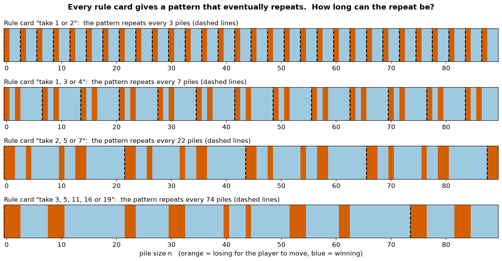
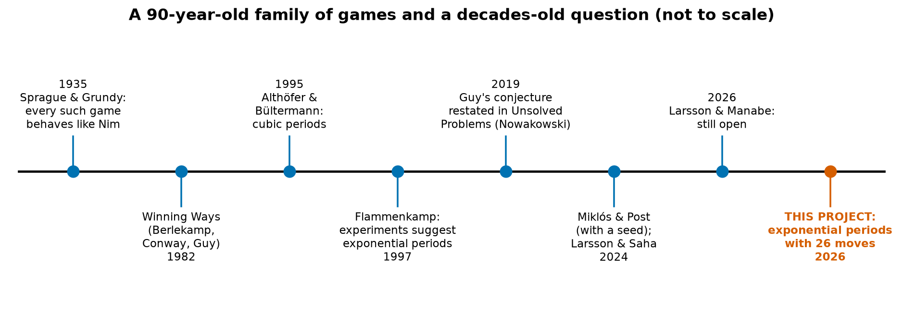

# Background: games, patterns, and a 30-year-old question

## 1. Games you can solve completely

Chess, Go and Nim are games of **perfect information** with **no chance**: both players see
everything and nothing is random. In such games, if both play perfectly, the outcome of every
position is already decided before anyone moves. The branch of mathematics that studies them is
called **combinatorial game theory**.

A particularly clean kind is the **impartial** game, where both players have the same moves.
Under the **normal play** convention the player who cannot move **loses**.

* **P-position** ("Previous player wins"): the player about to move loses against perfect play.
  In this folder we call these **losing piles**.
* **N-position** ("Next player wins"): the player about to move can force a win (**winning
  piles**).

Every position is one or the other, and there is a simple test:

> a position is P exactly when every move leads to an N-position.

## 2. Nim, Sprague and Grundy

* **1902.** Charles Bouton solved **Nim** (several piles, take any number from one pile): a
  position is losing exactly when the binary XOR of the pile sizes is 0.
* **1935 and 1939.** Roland Sprague and Patrick Grundy showed that **every** impartial game behaves
  like a single Nim pile of some size, its **nim-value** (Grundy value). A position is losing
  exactly when its nim-value is 0.
* **1982.** Elwyn Berlekamp, John Conway and Richard Guy published *Winning Ways for Your
  Mathematical Plays*, the bible of the subject, full of tables of **subtraction games**.

## 3. Subtraction games

A subtraction game is the simplest interesting impartial game: **one pile** and a **rule card**
S of allowed amounts. From a pile of n you may move to n − s for any s in S with s ≤ n.

Some examples:

| rule card S | losing piles | period |
|---|---|---|
| {1, 2} | 0, 3, 6, 9, … | 3 |
| {1, 3, 4} | 0, 2, 7, 9, 14, 16, … (n mod 7 = 0 or 2) | 7 |
| {2, 5, 7} | irregular at first, then repeats | 22 |
| {3, 5, 11, 16, 19} | | 74 |

**The periodicity theorem.** For every finite rule card the pattern eventually repeats (Golomb,
1966, for nim-values). The reason is simple. If the biggest move is m, the answer at pile n depends
only on the previous m answers, and there are only 2^m possible lists of m answers. So a list must
repeat, and from then on everything repeats. The length of the repeat is the **period**, and it is
at most 2^m.

## 4. The question: how long can the period be?

The upper bound 2^m is exponential in the largest move. But real games might be much tamer. For
one or two moves the periods are small (at most 2m). The natural guess is that periods stay
"polynomial".

| year | who | what |
|---|---|---|
| 1995 | Ingo Althöfer, Jörg Bültermann | families with **cubic** periods; they ask whether **super-polynomial** periods exist for 5 or more moves |
| 1990s–2019 | Richard Guy's *Unsolved Problems in Combinatorial Games* lists (continued by Richard Nowakowski; 2019 edition) | **Guy's conjecture:** for n moves the period is at most a polynomial of degree n(n−1)/2 in the largest move |
| 1997 | Achim Flammenkamp (PhD thesis, Bielefeld) | huge computer searches; record periods of 5-move games grow roughly like **2^(0.3 m)**; conjecture: **exponential periods exist** |
| 2016 | Mark Ward | a further conjecture about periods of subtraction games |
| 2024 | István Miklós, Logan Post | super-polynomial periods, but only for a **modified** game whose first outcomes are prescribed (a "seed"); they write that exponential periods are "a long time open question" |
| 2024 | Urban Larsson, Indrajit Saha (survey) | Flammenkamp's conjecture listed as Conjecture 1 |
| 2026 | Urban Larsson, Hikaru Manabe | still describe exponential periods as open |
| 2026 | **this project** | exponential periods **proved** with 26 moves; Guy's conjecture refuted |

## 5. Why was it hard?

* **The rule is the same everywhere.** Every pile size uses the same rule card. You cannot give
  special instructions to "pile 1000". Any structure has to emerge from the numbers on the card.
* **The dynamics look chaotic.** Along every simple family of 5-move rule cards we examined, the
  periods jump around erratically. Record periods can be found by brute force, but brute force
  cannot prove anything about *all* sizes.
* **You need a mechanism, not just data.** To prove a period is exponential, you need a reason the
  pattern must take that long to come back. Our reason is a counter.

## 6. What was known about how hard these games are

* With **two or more piles**, subtraction games were known to be extremely powerful. They can
  emulate cellular automata (Larsson and Wästlund 2013; Larsson 2012), which leads to undecidable
  questions, and Gurvich and Vyalyi (2021) proved PSPACE-hardness and exponential lower bounds for
  multi-dimensional subtraction games.
* Games **played on graphs** (Node Kayles, Geography, …) are PSPACE-complete.
* For **one pile**, where the outcome sequence is always eventually periodic, no hardness result
  was known. It was plausible that one-pile games were simply easy. They are not: one pile is
  already universal (see `04_results.md`).

## 7. Neighbours of this problem

* **Shift registers.** Hardware devices that remember the last m bits and compute the next one. With
  XOR feedback (LFSRs) they generate long pseudo-random sequences, up to 2^m − 1. Registers with
  **nonlinear** feedback (NLFSRs) are used in modern stream ciphers, and their periods are
  notoriously hard to analyse. A subtraction game *is* a nonlinear feedback shift register whose
  feedback is one NOR gate.
* **Cellular automata.** Rows of cells updated by a local rule. Some very simple rules, such as
  "Rule 110" (Cook, 2004) and Conway's Game of Life, turn out to be able to compute anything.
  Our result puts one-pile subtraction games in this family of "accidentally universal" systems.
* **Computational complexity.** P, NP, PSPACE, EXPTIME classify problems by the time or memory they
  need. Games are a classic source of hard problems.
