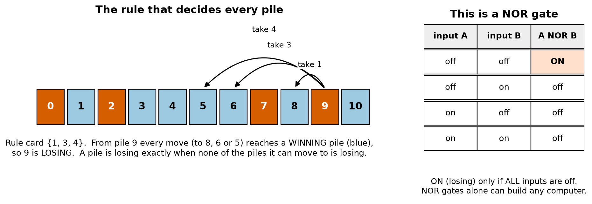
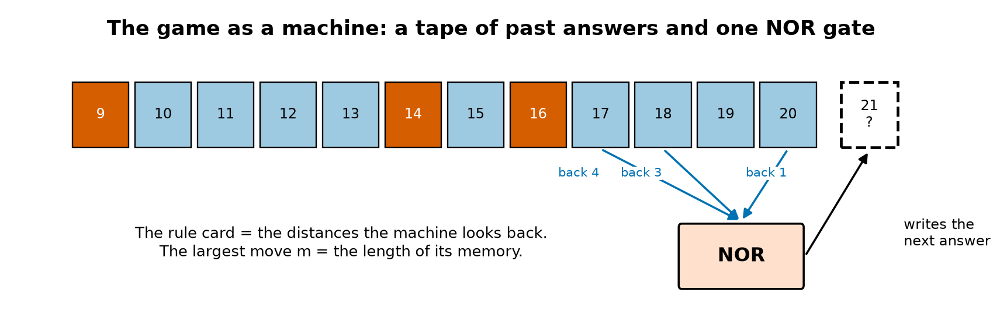
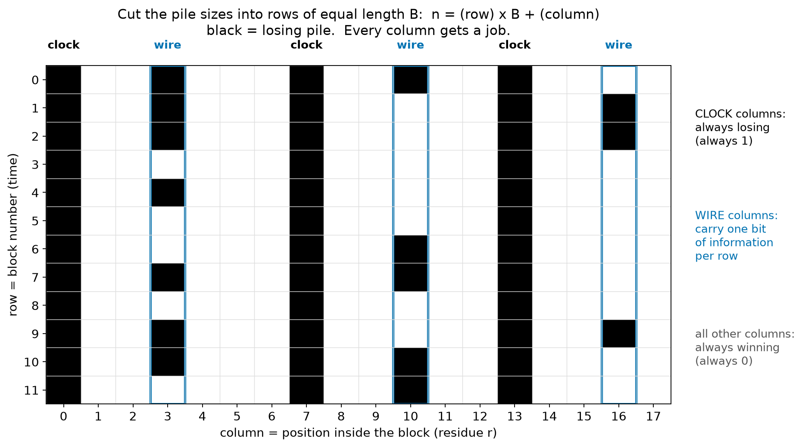
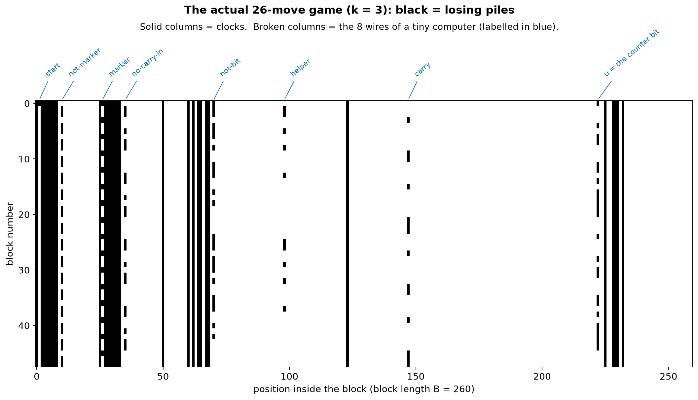
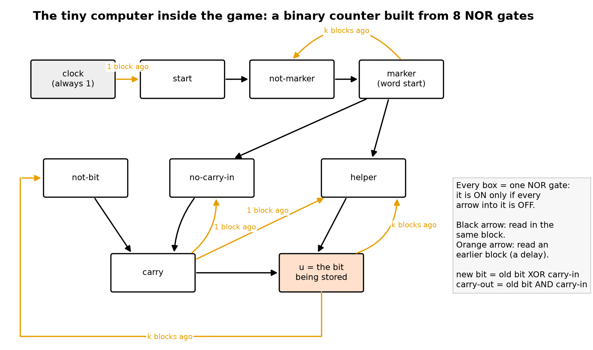
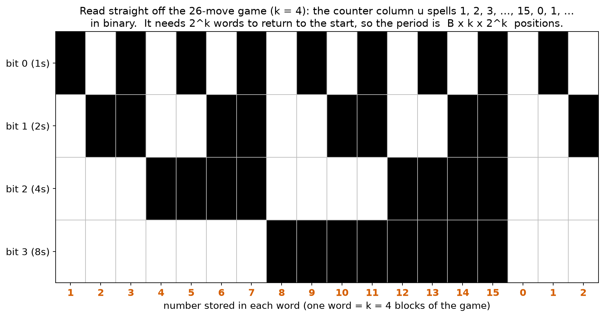
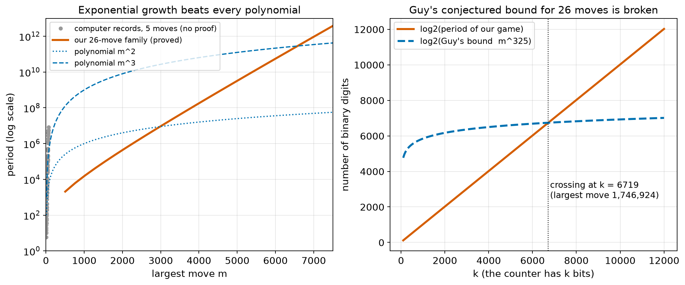
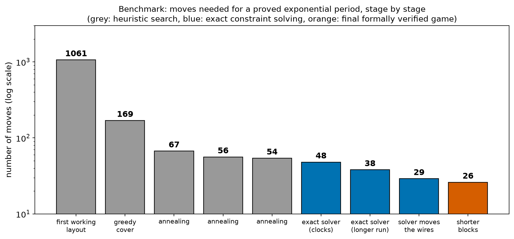
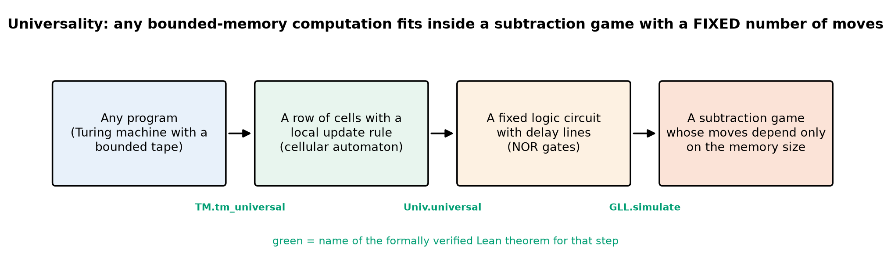
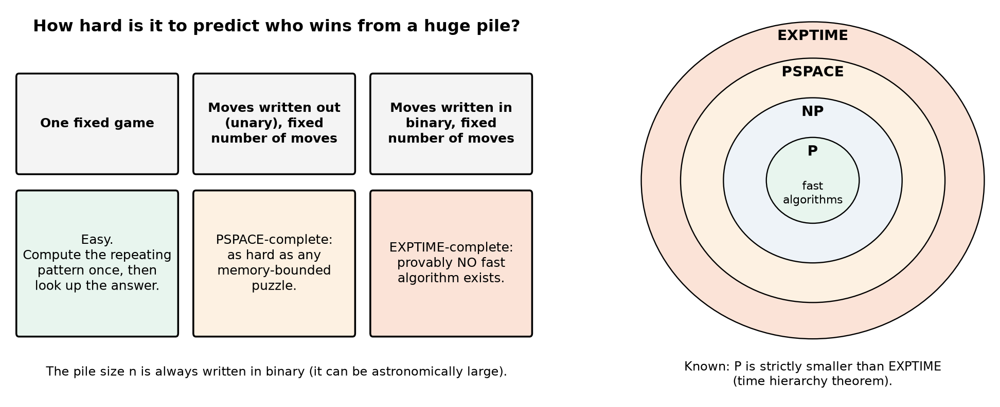

# How it works: turning a game into a computer

The proof rests on one idea: **a subtraction game can be made to behave like a digital circuit**.
Everything else follows from that. This page builds the idea in ten steps.

---

## Step 1. The rule that decides everything is a NOR gate

Write w(n) = 1 if pile n is **losing** for the player to move, and w(n) = 0 if it is winning. The
basic rule of the game:

> pile n is losing ⟺ none of the piles n − s (for s on the rule card) is losing.

In logic, "output 1 only if all inputs are 0" is a **NOR gate**:

  w(n) = NOR( w(n − s₁), w(n − s₂), …, w(n − s_k) ).

NOR gates are **universal**: every digital circuit, including a whole computer, can be built from
NOR gates alone. This is the first hint that the game might be able to compute.

## Step 2. The game is a machine with a memory

Computing w(0), w(1), w(2), … in order, each new value looks back at fixed distances (the numbers
on the rule card) into a tape of earlier values. That is a **shift register**: a memory of the
last m answers (m = the largest move) plus one NOR gate that writes the next answer.

## Step 3. Cut the pile sizes into blocks: time and place

Pick a block length B (ours is **B = 260**) and write every pile size as

  n = B · τ + r,  with 0 ≤ r < B.

Think of **τ as time** (which block) and **r as place** (where inside the block). Drawn as a grid,
each row is a block and each column is a place.

## Step 4. Give every column a job

We design the rule card so that every column behaves in one of three ways:

* **Clock columns:** always losing (value 1 in every block).
* **Zero columns:** always winning (value 0). A zero column needs at least one move that lands on a
  clock, because moving to a losing pile is a winning move.
* **Wire columns:** the value can change from block to block. Each wire carries **one bit of
  information per block**.

For this to hold, a clock must never be able to reach a clock or a wire (otherwise it would stop
being losing), and a wire must never be able to reach a clock (otherwise it would be stuck at 0).

## Step 5. A move is a wire with a time delay

Take a move s = B·q + δ (with 0 ≤ δ < B). Applied at place r of block τ, it lands at

* place r − δ of block τ − q, if r ≥ δ, or
* place r − δ + B of block τ − q − 1, if r < δ (it wraps into the previous block).

So **one move connects two columns (distance δ apart) with a delay of q or q + 1 blocks.** A move
of length about B·k reaches k blocks back in time, so it works as a **memory (delay line) of k
blocks**.

## Step 6. Wires compute NOR gates

Suppose the columns are arranged so that, from wire j, the moves land only on zero columns and on
a few chosen wires i₁, i₂, … with delays d₁, d₂, …. Then Step 1 says

  wire j at block τ = NOR( wire i₁ at block τ − d₁, wire i₂ at block τ − d₂, … ).

So **each wire is a NOR gate**, and the whole game is a synchronous circuit that ticks once per
block. We proved this in general and checked the proof in Lean (the *simulation theorem*): if a
list of finitely many layout conditions holds, the losing piles are exactly the clock positions
plus the wire positions whose logic value is 1.

## Step 7. The catch: one rule for every place

Every move acts on **every** column at once. A move meant to connect wire A to wire B also connects
every other pair of occupied columns at the same distance. Those unintended connections would
break the circuit. So the occupied columns must be spread out so that the distances between them
are all different, except for the ones we want. (Sets with all pairwise distances different are
called **Sidon sets**.) On top of that, every zero column needs a move that lands on a clock, and
we want as **few moves** as possible.

This is a hard combinatorial puzzle, and it was solved by computer (Step 10). The solution has
B = 260, 29 clock columns, 8 wire columns and just 26 moves:

## Step 8. The circuit we build: a binary counter

Eight NOR gates are enough for a **bit-serial binary counter**:

* **start** is 1 only in block 0. It reads a clock one block back, which does not exist in block 0.
* **marker** is 1 at the first block of every **word** (every k blocks). It is a loop through
  not-marker that repeats every k blocks.
* **u** is the bit being stored. Two long moves (length about 260k) let not-bit and helper read u
  from exactly k blocks earlier, so the k blocks of a word hold a k-bit number, least significant
  bit first.
* **no-carry-in, not-bit, helper, carry** do "add 1": new bit = old bit XOR carry-in, and
  carry-out = old bit AND carry-in. At the start of every word the carry-in is forced to 1 by the
  marker.

So **every word stores one more than the previous word**:

## Step 9. The period, exactly

A k-bit counter returns to its starting value after 2^k increments, each word is k blocks, and
each block is 260 positions:

  **period = 260 · k · 2^k.**

We also proved that no smaller period works:

1. **Clocks force multiples of 260.** Shifting by a non-multiple of 260 moves some clock column
   onto a zero column, which is a finite check over the 259 possible shifts.
2. **The marker forces multiples of k blocks.** It is 1 exactly once per word.
3. **The counter forces multiples of 2^k words.** The stored numbers must come back.

Since the largest move is 260k − 16, the period is (max S + 16) · 2^((max S + 16)/260), which is
**exponential in the largest move**. Polynomials cannot keep up: for 26 moves, Guy's bound of
degree 26·25/2 = 325 is overtaken at k = 6719.

## Step 10. How the 26 numbers were found

1. **Sidon grids** (1061 moves). Put the wires on a coarse grid at positions forming a Sidon set,
   and put the clocks in residue classes that avoid each other. This gave the first design that
   works, but a wasteful one.
2. **Greedy set cover** (169). One move can cover many zero columns at once, so choose covering
   moves greedily.
3. **Simulated annealing** (67 → 54). Randomly nudge wires, clocks and the block length, keeping
   changes that reduce the move count.
4. **Exact constraint programming** (48 → 38). Encode "clock never sees clock", "each zero sees a
   clock", … as Boolean constraints and let a solver (Google OR-Tools CP-SAT) find the minimum.
5. **Large-neighbourhood search** (29). Let every wire move a few places and re-solve.
6. **Shorter blocks** (26). The 29-move layout used only columns up to 219 of 377, so the solver
   was asked for shorter blocks, and found 26 moves with B = 260.

Every candidate was checked by an exact verifier and by simulating the actual game, and the final
design was checked again, completely, inside Lean.

---

## Beyond counting: the game can run any program

The counter is one circuit. The same layout method works for **every** circuit (the *General
Layout Lemma*), which is also proved in Lean. Going further, we built a **single fixed circuit**
that, given a ring of L cells:

1. counts through all possible inputs X = 1, 2, 3, … (an input counter),
2. for each input, runs a cellular automaton for 2^L steps (a timer), then
3. starts again with the next input.

Laid out as a game, its moves depend only on L. So **one family of games with a bounded number of
moves simulates a given cellular automaton (and hence a Turing machine) on every input.** This is
proved in Lean (`Univ.universal`, `TM.tm_universal`).

Consequence: deciding who wins from a huge pile is as hard as any bounded-memory computation
(PSPACE-complete). With the moves written in binary it is EXPTIME-complete, so there is provably
no fast algorithm.

