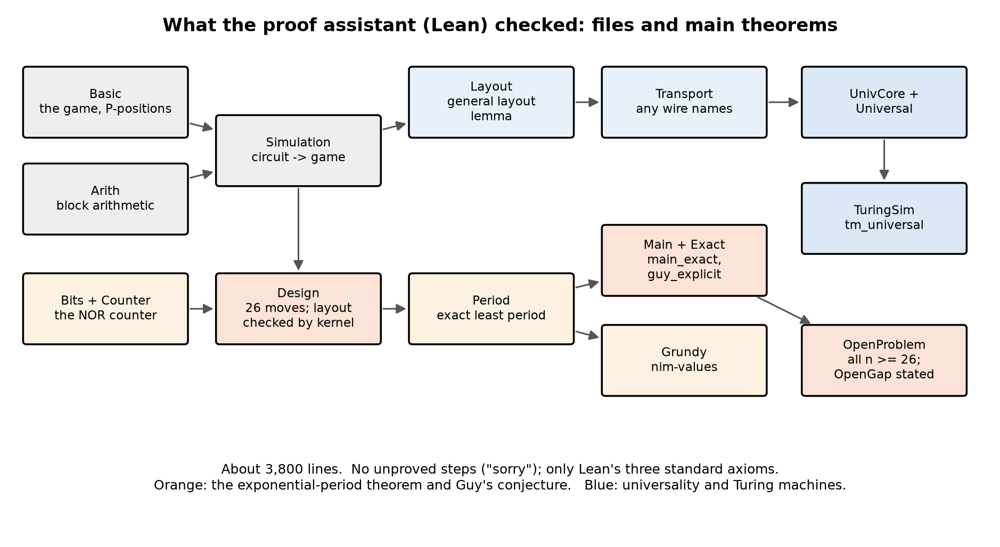
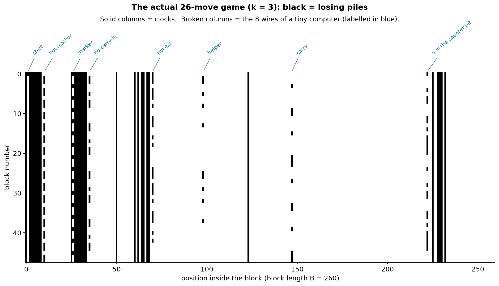

# How we know it is true

A surprising claim needs strong evidence. This project has three independent layers of it.

## Layer 1. A machine-checked proof (Lean)

**What is Lean?** Lean is a *proof assistant*: a programming language in which mathematical
statements and proofs are written so precisely that a small, trusted program (the **kernel**) can
check every logical step. If Lean accepts a proof, the only ways it can be wrong are a bug in the
small kernel (which is heavily scrutinised), a false axiom, or a statement that does not say what
we think it says. Mathematicians increasingly use Lean for exactly this reason, and **Mathlib**,
its library, contains a large part of undergraduate and graduate mathematics.

**What we proved in Lean** (about 3,800 lines, Lean 4.33.1 with Mathlib):

| theorem | says |
|---|---|
| `Concrete.main_exact` | the 26-move game has exactly 26 moves, largest move 260k − 16, least period 260·k·2^k, and period > 2^(max S/260) |
| `Concrete.guy_explicit` | at k = 6719 the period beats (max S)^325 |
| `superPoly_of_ge`, `guy_false_of_ge` | super-polynomial periods, and failure of Guy's bound, for every n ≥ 26 moves |
| `Concrete.nim_period_dvd` | the nim-value period is a multiple of the outcome period |
| `GLL.simulate` | every NOR circuit can be laid out as a subtraction game |
| `Univ.universal` | universality with a bounded number of moves (cellular automata) |
| `TM.tm_universal` | Turing machines with bounded tape are simulated on every input |
| `OpenGap` | the open problem 3 ≤ n ≤ 25, stated precisely (a definition, not a proof) |

**Why you can trust the statements, not just the proofs:**
* The game is defined **directly**: `outcome L n` says "no legal move from n leads to a position
  with outcome = true", by recursion on n. It does not mention blocks, clocks or circuits. So the
  theorems are about the real game, not a model of it.
* **Sanity checks** in Lean confirm the definition behaves as expected: the rule card {1, 2} gives
  losing piles exactly at multiples of 3, and {1, 3, 4} gives exactly n ≡ 0 or 2 (mod 7).
* **Period** is defined in the standard way: p is a period if w(n + p) = w(n) for all
  sufficiently large n. We prove the stated period is one, and that every period is a multiple of
  it.
* `#print axioms` reports only `propext`, `Classical.choice` and `Quot.sound`, the standard
  foundations of mathematics in Lean. There is no `sorry` (a placeholder for a missing proof) and
  no `native_decide` (which would trust compiled code).

**How the finite part is checked.** The layout of the 26-move game (which columns are clocks, which
moves land where) involves finitely many conditions: 260 columns times 26 moves. Lean's kernel
checks each one by computation (`decide +kernel`). This is the slowest part of the build, about 30
minutes on a laptop.

**Rebuild it yourself:** `cd lean && lake exe cache get && lake build`.

## Layer 2. Direct simulation

Separately from Lean, a small C program plays the game position by position using only the
definition (a pile is losing exactly when no move reaches a losing pile). For k = 2 to 6:

* every position agrees with the predicted pattern (clocks, zeros, and the counter wires), and
* the least period comes out as exactly 2080, 6240, 16640, 41600, 99840 = 260·k·2^k. The script
  checks that no proper divisor of the period works.

The universal constructions were simulated too: 24 million positions of a real universal game with
123,181 moves, all 256 elementary cellular automaton rules through the universal circuit, and a
Turing-machine reduction on all 254 inputs of length up to 7, all with **zero mismatches**.

Reproduce everything: `bash subgame/run_all_checks.sh`.

## Layer 3. A written proof

The paper (`paper/paper.pdf`, 15 pages) gives a traditional human-readable proof of every result,
so a mathematician can check the ideas without Lean.

## What is *not* machine-checked (honest limits)

* **The complexity classes themselves.** Lean's library has no notion of PSPACE or EXPTIME. We
  formally prove the *simulation* (games simulate Turing machines), but the bookkeeping steps are
  written on paper: choosing a machine for a PSPACE-complete language, and checking that the
  translation runs in polynomial time.
* **The two-parameter construction for EXPTIME.** It was checked by exhaustive simulation, but it
  is not in Lean.
* **"First" is a literature claim.** Our searches (including the 2024 survey and a March 2026
  paper that still lists the question as open) found no earlier proof. Novelty is always best
  confirmed by experts; see `08_judge_questions.md`.
* **The number 26 is not optimal.** It is the best found so far. The solver's lower bounds are far
  below 26.
