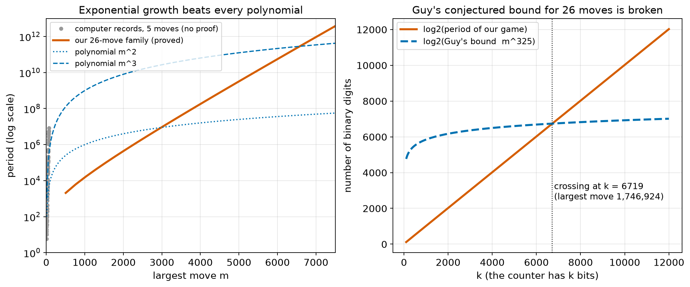

# Why it matters: applications and impact

This is pure mathematics and theoretical computer science, so its value is mostly the knowledge
itself and the methods. It also connects to several practical areas. Below, **"direct"** marks
things the project actually shows, and **"connection"** marks places where it informs other fields
without solving their problems.

---

## 1. Mathematics: closing a long-standing question (direct)

* **Settles** whether subtraction games with a bounded number of moves can have super-polynomial
  periods. They can: exponential. This refutes **Guy's conjecture** and confirms **Flammenkamp's
  conjecture**, questions in the field's standard list of unsolved problems.
* **A new method.** The "blocks, clocks and wires" technique turns questions about periods into
  questions about circuits, which can be answered by design. It should apply to other take-away
  games (octal games, games with several piles, misère play) whose periodicity is also mysterious.
* **Sharpens the open problem** to a precise gap: 3 ≤ n ≤ 25 moves.

## 2. Computer science: games that are provably hard to predict (direct)

* **PSPACE- and EXPTIME-completeness for one pile.** Hardness was known for many-pile games and for
  games on graphs. This project shows that **a single pile with a bounded number of moves** already
  has the full difficulty.
* **An unconditional lower bound.** Most hardness results in computer science depend on unproved
  beliefs such as "P ≠ NP". The EXPTIME result does not: by the time hierarchy theorem, there is
  **no** fast algorithm for deciding who wins these games when the numbers are written in binary.
* **Simple rules can compute.** A one-pile subtraction game is about the simplest dynamical system
  imaginable: a list of bits, each determined by one NOR of a few earlier ones. Showing it is
  **universal** adds it to the family of surprisingly powerful simple systems, alongside Conway's
  Game of Life and the cellular automaton Rule 110.

## 3. Pseudo-randomness and cryptography (connection)

A subtraction game is a **nonlinear feedback shift register (NLFSR)**. NLFSRs are core components of
stream ciphers used in practice, such as Grain and Trivium, and two questions matter a lot for
them:

* **How long is the period?** A short period makes a cipher predictable. Periods of nonlinear
  registers are notoriously hard to analyse. Our construction gives registers with very few taps
  whose period is **provably** exponential and computed **exactly**.
* **How hard is it to predict the output?** Our complexity results show that, in general,
  predicting a far-future bit of such a register can be as hard as any memory-bounded computation.

*Caveat:* our registers are deliberately structured (they count), so they are **not** secure
pseudo-random generators. The connection is that our tools, exact period analysis and embedding
computation, are the kind of tools used to study these devices.

## 4. Hardware history: computing in a delay line (connection)

Our counter stores its bits in a **delay line**: a long move reads a value from k blocks earlier.
That is exactly how some of the first computers stored memory. EDSAC (1949) and UNIVAC I (1951)
kept bits circulating in mercury delay lines. In a sense, the subtraction game rebuilds a
1940s-style serial computer out of pure arithmetic. This makes a good story for a general audience.

## 5. Artificial intelligence and game playing (connection)

Game-playing programs evaluate positions. Our results show that even for a game as simple as
"take 9, 11, 13, … tokens from one pile" there is **no shortcut** in general. A program must
effectively run a computation that can be as long as the game's hidden computer requires. This is
a clean example of why AI for games cannot rely on finding simple patterns.

## 6. How mathematics gets done: search + solver + proof assistant (direct)

The project is a working example of a modern research pipeline:

1. **Computer experiments** suggest what is true (exponential periods, from Flammenkamp's data and
   ours).
2. **A construction idea** (the game as a circuit) turns the question into a design problem.
3. **Search and exact optimisation** (annealing, constraint solvers) find a concrete design (26 moves).
4. **A proof assistant** certifies the whole argument, including the parts found by computer.

Big results have been verified this way before: the Four Colour Theorem, the Kepler conjecture
(Flyspeck) and the Liquid Tensor Experiment. This project shows the same pipeline at a scale that
a single motivated person with a laptop and modern tools can carry out.

## 7. Teaching (direct)

Anyone can play the game with coins. From there the project leads naturally to logic gates, binary
counting, the pigeonhole principle, exponential versus polynomial growth, complexity classes, and
what a proof is. The `demo.py` script and the diagrams in this folder are designed for exactly that.

