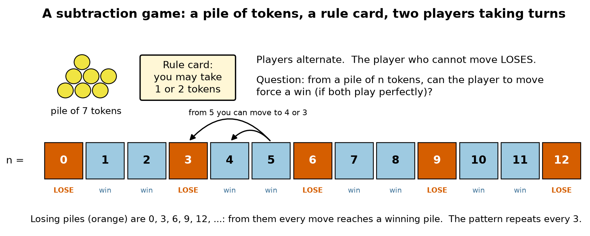
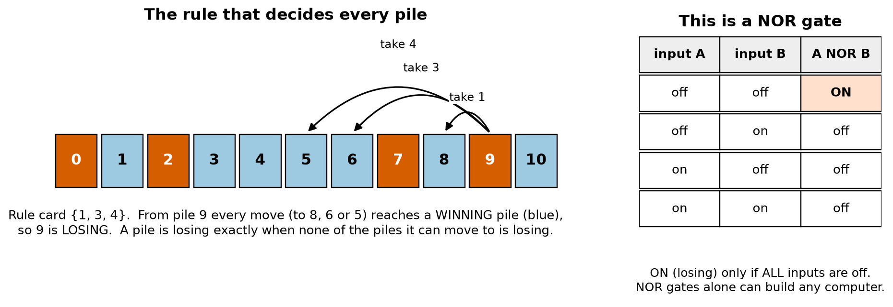
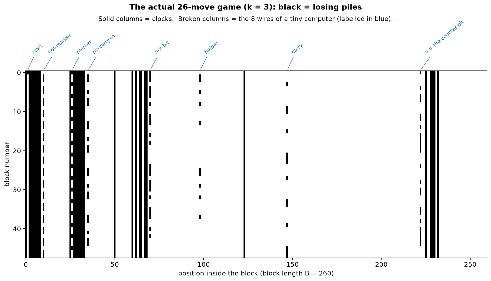
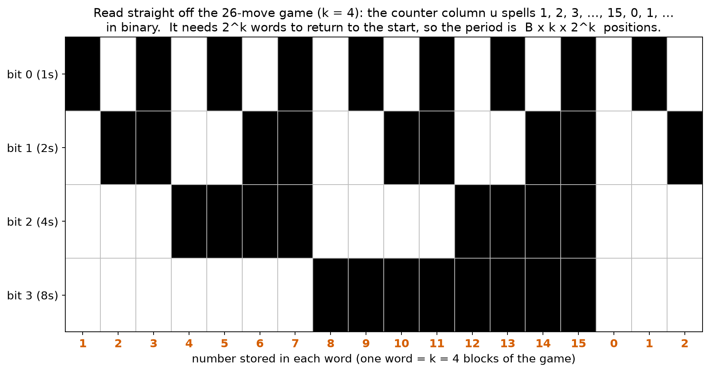
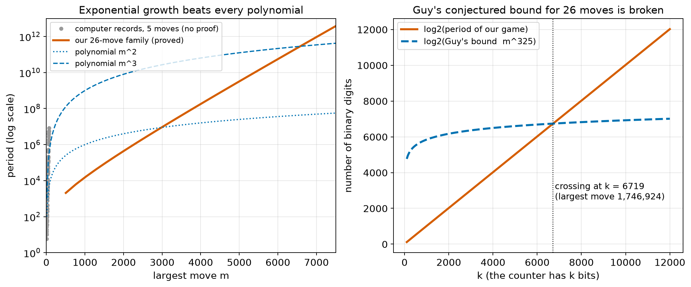
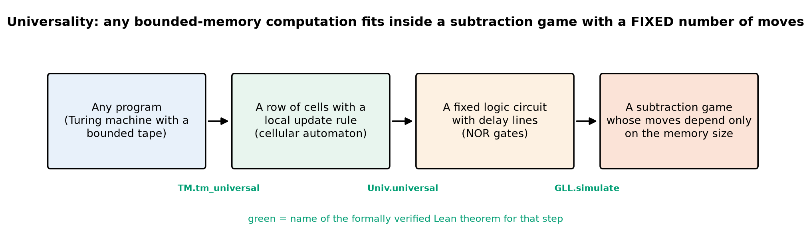

# STS material: "Subtraction Games Can Count and Compute"

This folder explains the project to people who have never seen it: judges, teachers, friends,
family, and you. The scientific paper is `../paper/paper.pdf` and the machine-checked proofs are in
`../lean/`. Everything here is written so that it can be read without either of those.

## The project in five sentences

1. In a **subtraction game**, two players take turns removing tokens from a pile. A rule card lists
   the amounts you may take, and whoever cannot move loses.
2. For every rule card, the list of winning and losing pile sizes eventually **repeats**. For about
   30 years mathematicians have asked how long that repeat can be. Richard Guy conjectured it is
   always "polynomially" short, while computer experiments hinted that it can be exponentially long.
3. We **proved** that it can be exponentially long. There is an explicit rule card with just
   **26 numbers** whose pattern takes about **2^(max/260)** steps to repeat, so **Guy's conjecture
   is false**.
4. The trick is a surprise discovery: the game can be turned into a **tiny computer**. With the
   right numbers it runs a binary counter, and more generally it can simulate **any** computer
   program with bounded memory. So predicting the winner is provably hard.
5. Every step of the main proof was **checked by a computer proof assistant (Lean)**, the
   mathematical equivalent of an unbeatable fact-checker.

## What is in this folder

| file | what it is | read it if you want... |
|---|---|---|
| [`01_explain_like_im_5.md`](01_explain_like_im_5.md) | the whole story at three levels: age 5, age 12, high school | the idea in 2 minutes |
| [`02_background.md`](02_background.md) | games, Nim, 90 years of history, the open question | context and why it mattered |
| [`03_how_it_works.md`](03_how_it_works.md) | the key ideas step by step, with pictures | to understand the proof |
| [`04_results.md`](04_results.md) | every result in plain words and in exact form | the precise claims |
| [`05_how_we_know_its_true.md`](05_how_we_know_its_true.md) | proof checking (Lean), simulations, honest limits | to trust (or audit) it |
| [`06_applications_and_impact.md`](06_applications_and_impact.md) | why it matters: computer science, cryptography, AI, math | the "so what?" |
| [`07_open_problems_and_whats_next.md`](07_open_problems_and_whats_next.md) | what is still unknown, and how to continue | the future |
| [`08_judge_questions.md`](08_judge_questions.md) | 40 likely interview questions, with answers | to prepare for judging |
| [`09_presentation_kit.md`](09_presentation_kit.md) | 30-second / 2-minute / 5-minute talks, poster plan, demo | to present it |
| [`10_glossary.md`](10_glossary.md) | every technical word, explained | when a word is unfamiliar |
| [`11_key_numbers.md`](11_key_numbers.md) | the numbers worth memorising | a one-page cheat sheet |
| [`demo.py`](demo.py) | a live demo you can run anywhere (plain Python, no installs) | to show it working |
| [`diagrams/`](diagrams/) | 15 pictures, all computed from the real games | slides and posters |
| [`make_diagrams.py`](make_diagrams.py) | regenerates every picture (`python make_diagrams.py`) | to change a picture |

## Suggested reading orders

* **A curious friend or family member:** `01` → the pictures in `diagrams/` → `06`.
* **A judge with 10 minutes:** `11_key_numbers` → `04_results` → `03_how_it_works` (skim the pictures).
* **You, preparing for the interview:** `03` → `04` → `05` → `08` (twice) → `09`.
* **A mathematician:** `04_results` → `05` → the paper → the Lean files.

## The pictures at a glance

| | |
|---|---|
|  |  |
| the game and its losing piles | the rule is a NOR gate |
|  |  |
| the real 26-move game, with its 8 "wires" | the game counting in binary |
|  |  |
| exponential beats polynomial | any program fits inside a game |

## Running the demo

```
python demo.py            # interactive menu
python demo.py all        # run every part
```

It needs only Python 3 (no extra packages). It plays small games, shows the repeating pattern,
and then shows the 26-move game counting in binary, read straight from the pile sizes.

## A note on integrity

This project used computers heavily: search programs, a constraint solver, a proof assistant, and
an AI assistant (Claude) that helped write code, search, and formalize proofs. Regeneron STS
requires the research to be the student's own and has rules about AI assistance, so read the
current rules, describe the AI's role honestly in your forms, and make sure you can explain every
step yourself. These materials exist to make that possible. The strongest thing you can say to a
judge is exactly what you did, what the tools did, and how you checked the tools.
